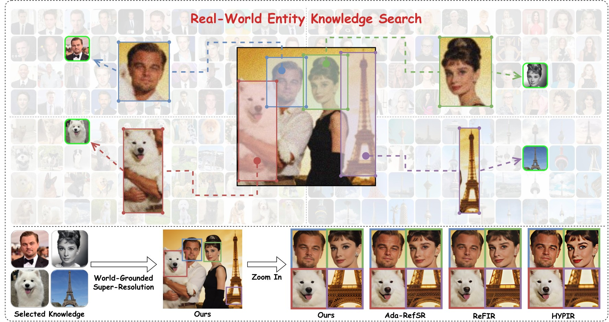

<h1 align="center">WorldSR: Harnessing World Knowledge Search for Grounded Image Super-Resolution</h1>

<p align="center">
  <a href="https://gwanjyun.github.io/worldsr.github.io/"></a>
  <a href="#"></a>
  <a href="#"></a>
</p>

<p align="center"><strong><a href="https://scholar.google.com/citations?user=SsG0abgAAAAJ&hl=en">Junyuan Deng</a><sup>1</sup>, <a href="https://scholar.google.com/citations?user=7JvBwK0AAAAJ&hl=en">Xinyi Wu</a><sup>1</sup>, <a href="https://scholar.google.com/citations?user=FrRQragAAAAJ&hl=en">Zhenyao Wu</a><sup>1,✉</sup>, <a href="https://scholar.google.com/citations?user=eycXl_QAAAAJ&hl=en">Song Wang</a><sup>1,2</sup>, Yu Wang<sup>1</sup>, Congchao Zhu<sup>1</sup></strong></p>

<p align="center"><sup>1</sup> <a href="https://www.honor.com/global/">Honor Device Co., Ltd</a> &nbsp;·&nbsp; <sup>2</sup> Shenzhen University of Advanced Technology</p>

<p align="center"><sup>✉</sup> Corresponding author &nbsp;·&nbsp; <strong>NeurIPS 2026</strong></p>

<p align="center">
  
</p>

---

## 🔗 Links

| | |
|---|---|
| 🌐 **Project Page** | **https://gwanjyun.github.io/worldsr.github.io/** |
| 📄 **Paper (arXiv)** | *Coming Soon* |
| 🤗 **Datasets (Hugging Face)** | *Coming Soon* |

---

## 📖 Abstract

Generative-prior-based super-resolution (SR) methods leverage implicit knowledge learned from large-scale models to enhance low-resolution inputs. However, such priors are inherently stochastic and optimized for diverse generation, conflicting with the deterministic, high-fidelity reconstruction required for SR. It is also tied to the base model, costly to update, and prone to hallucinations as real-world data evolves.

To address these limitations, we introduce **WorldSR**, a novel framework that augments SR with explicit, entity-aligned visual world knowledge. WorldSR automatically decomposes the input into semantic entities and performs entity-wise retrieval of structurally and semantically aligned images from a large-scale external corpus. For efficiency and reliability, we incorporate a memory mechanism to reuse previously retrieved results and a multi-step filtering process to refine candidate references. The selected references as world knowledge are then integrated through a novel multi-reference super-resolution model, which provides fine-grained constraints for detail synthesis and structural recovery. Experiments on real-world SR benchmarks show that WorldSR consistently improves structural fidelity and visual quality, outperforming existing generative super-resolution methods. Our results suggest that entity-level grounding in external visual world knowledge provides a simple and effective complement to model-bound generative priors.

---

## 🧩 Method

WorldSR is an agent-style framework operating in an iterative refinement loop with five key components:

1. **Agentic ROI Planner** — An MLLM performs entity-level semantic reasoning on the input and produces open-world ROI bounding boxes; corresponding image patches are cropped for downstream retrieval, with an iterative loop feeding intermediate SR results back as visual feedback.
2. **Memory Verifier** — A Memory Bank caches previously explored ROIs together with their filtered world knowledge. A Decision-Making Controller routes each query by IoU: memory hits skip redundant search, and all-hit queries terminate the refinement loop.
3. **World Knowledge Searcher** — A dual-engine retrieval strategy combines web-scale reverse image search (high-resolution source scraping) with a local knowledge base searched via visual-encoder embeddings and cosine similarity, merging candidates into a unified set.
4. **World Knowledge Filter** — Candidates are refined through quality-aware filtering (IQA models), irrelevant region pruning (MLLM grounding), and semantic-aware reference ranking, selecting the optimal reference per entity.
5. **World-Grounded SR Model** — Reference Quality Refinement first restores retrieved references; Reference-Guided SR then formulates multi-reference super-resolution as unified sequence modeling over a text-to-image DiT with a dual-LoRA design decoupling LR- and reference-domain tokens.

The world-grounded SR model is built on a pretrained text-to-image DiT backbone (Flux.2-dev) with three LoRA adapters (θ<sub>RQR</sub>, θ<sub>LR</sub>, θ<sub>Ref</sub>) trained via QLoRA. LR tokens and reference tokens are concatenated along the sequence dimension, enabling unconstrained global interactions and faithful knowledge injection.

---

## 📊 Results

WorldSR achieves state-of-the-art performance across real-world SR benchmarks, including **RealLQ250**, **Bird**, **Face**, **WRSR**, and **CUFED5**. It surpasses the second-best face-specific approach by **+6.4%** IDS on the Face dataset, and is the best performer across all no-reference metrics on CUFED5.

See the [project page](https://gwanjyun.github.io/worldsr.github.io/#results) for the full quantitative tables and qualitative comparisons.

---

## 🎬 Applications

Beyond benchmarks, WorldSR plugs into real-world applications — for each degraded input, a sharp reference is retrieved via entity-level search, and the world-grounded SR model restores it:

- **Smartphone 100× Telephoto Restoration**
- **ID Photo Enhancement** (fixing identity-fidelity issues of generated ID photos)
- **AIGC Repair**
- **3D Gaussian Splatting Refinement**
- **Video Super-Resolution**

Interactive before/after demos are available on the [project page](https://gwanjyun.github.io/worldsr.github.io/#applications).

---

## 📝 Citation

```bibtex
@inproceedings{deng2026worldsr,
  title     = {WorldSR: Harnessing World Knowledge Search for Grounded Image Super-Resolution},
  author    = {Deng, Junyuan and Wu, Xinyi and Wu, Zhenyao and Wang, Song and Wang, Yu and Zhu, Congchao},
  booktitle = {Advances in Neural Information Processing Systems (NeurIPS)},
  year      = {2026}
}
```

---

## 📮 Contact

For questions, please contact [dengjy27@mail2.sysu.edu.cn](mailto:dengjy27@mail2.sysu.edu.cn).